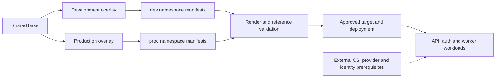

# Kustomize Multi-Environment Kubernetes

[](https://kubernetes.io/)
[](https://kubectl.docs.kubernetes.io/)
[](https://learn.microsoft.com/azure/aks/csi-secrets-store-driver)
[](https://ahmed-el-mahdy.github.io/)

A working base-and-overlays example for three Kubernetes workloads, with distinct development and production configuration.

## What This Repository Demonstrates

- Shared Deployments and Services for API, authentication, and worker workloads.
- Environment-specific namespaces, image tags, replicas, resources, ingress, and Key Vault references.
- Health probes and an HPA for the API workload.
- Azure Secrets Store CSI integration without committing application secrets.
- Local rendering before any cluster-side change.

## Configuration Model



## Implemented Layout

```text
.
|-- base/
|   |-- common/
|   |-- api-service/
|   |-- auth-service/
|   `-- worker-service/
`-- overlays/
    |-- dev/
    |   `-- patches/
    `-- prod/
        `-- patches/
```

Only `dev` and `prod` overlays are implemented. QA and staging are intentionally not claimed until their manifests and validation exist.

## Environment Differences

| Concern | Development | Production |
| --- | --- | --- |
| Namespace | `dev` | `prod` |
| Image tags | `dev-latest` | `prod-v1.0.0` |
| Replicas | Reduced for low-cost testing | Increased for workload availability |
| Resources | Base requests and limits | Production resource patches |
| Key Vault | `myplatform-dev-kv` | `myplatform-prod-kv` |
| Ingress | Disabled | NGINX ingress with TLS placeholders |

## Render and Validate

Rendering is read-only and should be the first check:

```bash
kubectl kustomize overlays/dev > dev-rendered.yaml
kubectl kustomize overlays/prod > prod-rendered.yaml

kubectl apply --dry-run=client -f dev-rendered.yaml
kubectl apply --dry-run=client -f prod-rendered.yaml
```

If the standalone Kustomize CLI is installed, `kustomize build overlays/dev` and `kustomize build overlays/prod` provide the same rendered output.

## Deploy

Applying changes requires an authenticated cluster context and changes workload state:

```bash
kubectl apply -k overlays/dev
```

Inspect the rendered output and confirm the active context before applying. Production should be delivered through an approved CI/CD or GitOps workflow rather than an operator laptop.

## Prerequisites

- Kubernetes cluster with the Azure Key Vault provider for Secrets Store CSI.
- Workload or managed identity authorized to read the referenced vault secrets.
- NGINX Ingress and cert-manager before using the production ingress example.
- Images available at the configured registry paths.

## Security and Operations Notes

- Replace placeholder tenant IDs, vault names, registry names, and DNS hosts.
- Pin images to immutable tags or digests for controlled promotion.
- Add Pod Disruption Budgets, NetworkPolicies, service accounts, and pod security controls for production.
- Validate custom resources against the cluster versions used by the target environment.
- Keep secret values in Key Vault; this repository stores only secret object names.

## Status

This is a focused Kubernetes configuration pattern. The development and production overlays render from the same base and are designed to be consumed by CI/CD or GitOps automation.

## Review Gates

Source review: 30 October 2026. Render both implemented overlays and check namespace, selectors, container/service ports, ConfigMap/Secret references, image identity, HPA target and actual probe contracts. Controller CRDs, CSI identity, registry access, TLS and application readiness need target-specific validation; local rendering does not prove them.

Use the approved cluster context for any server dry-run or apply. Keep a known-good image and desired-state recovery path; HPA, disruption budgets, network policy and secret refresh are separate controls. QA/staging, Gateway API and an automatic rollback controller are not implied by this dev/prod example.

## Experience Connection

This three-workload, two-overlay example demonstrates configuration reuse and local render validation; it is not the employer's five-overlay platform or its historical migration topology.

- [Career summary and CV bullets](https://github.com/ahmed-el-mahdy/Career-Advance/blob/main/progress/CV-BULLETS.md) keep reference-project scope separate from production achievements.
- [End-to-end migration story](https://github.com/ahmed-el-mahdy/Career-Advance/blob/main/progress/STAR-ANSWERS.md#star-9-end-to-end-staging2-migration) covers immutable images, exact CSI key coverage, workload checks and routing gates.

Experience material was reviewed on 30 October 2026. Rendered manifests do not prove live routing, secret access or application health; validate those independently.
